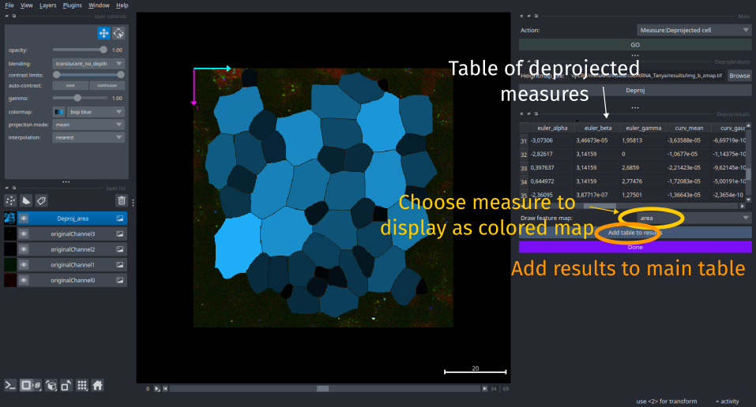

!!! abstract "Measure deprojected cell shape"
	_To measure cell properties with correction for the 2D projection artifacts, choose the Measures:Deprojected cells in the main pipeline interface._

This step allows you to measure morphological properties of cells, like their area or perimeters, while correcting for errors incurred when projecting from 3D to 2D.

When the tissue has a strong curvature, projection from 3D to 2D and then measuring cell properties on the 2D projection, such as area or perimeter, can generate small estimation error on the cell property (see [deproj webpage](https://github.com/Image-Analysis-Hub/DeProj/tree/master#measuring-cell-morphologies-on-2d-projections)).

If while doing the projection the mapping between the 3D and the 2D projection was saved, what we call the height map, it is possible to get a better estimate of the cell 3D properties. 
[`Deproj`](https://github.com/Image-Analysis-Hub/DeProj/tree/master) is a matlab framework developed to estimate correct cell properties, see [Herbert et al. 2021](https://doi.org/10.1186/s12915-021-01037-w). 
[`Deprojpy`](https://github.com/zen-laboratory/DeProjPy) is a new implementation of the core algorithm, implemented in python and extended with new capabilities to make it compatible with the `FishFeats` pipeline.
`FishFeats` relies on `deprojpy` to perform the deprojected calculation of cell properties.

To use it, you have to precise the file that contains the z-map information (the real 3D position of each projected pixel). 
When performing the 3D -> 2D projection, ensure that your method or tool allows saving of this file, along the projection results. For instance, when using [`LocalZProjector`](https://github.com/Image-Analysis-Hub/LocalZProjector) you need to check "Show reference plane movie". If such option is not available in your tool, you can go to the step [`Cells:3D position`](./3d-cell-positions.md) in `FishFeats` and check the option `Save Zmap`. 
Additionally, [`LocalZBackProj`](https://github.com/Image-Analysis-Hub/localZBackProjector) can also be used to estimate and build the z-map from the projection and the original 3D image.

Select the file that contains the z-map and click on `Deproj` to estimate the correct cell properties.
A table with the measures will be displayed in the right side of the interface when the computation is done.
See [`Deprojpy`](https://github.com/zen-laboratory/DeProjPy) documentation for the description of the measurements.

You can display the value of the deproj measure in each cell by selecting the corresponding feature in the `Draw feature map` option list.

To add the new measurements to the main `FishFeats`table results that is saved in the `results.csv` file and reloaded every time, press the button `Add to results` before finalizing and closing the deprojection step.
The added quantities that come from deprojected measurements are added with `Deproj_` prefix to the name of the measure (e.g. `Deproj_area`).
Hence, the measure of cell area ideally should be from the `Deproj_area` column that contains the corrected measure, while `Area` column would contains the purely 2D measure. 
